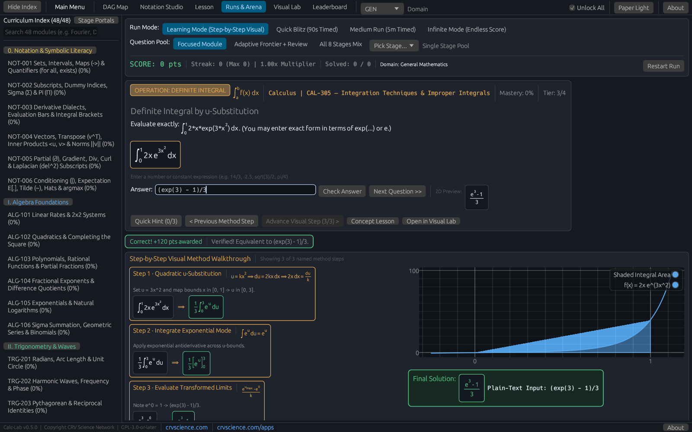

# CalcLab v0.5.0 — Native Rust Mathematics, Notation Literacy, PDEs & Statistical Inference Workbench



A standalone native Rust desktop application (`eframe` / `egui` + `egui_plot` + bundled `rusqlite`) featuring a distraction-free **Main Menu Hub**, **8 Stage Portals with Focused 6-Module Drill-Down Views**, an interactive **Notation Studio**, **Timed Game Modes** (`Quick Blitz 90s`, `Medium 5m`, `Infinite`), **Step-by-Step Visual Method Walkthroughs**, **6 Scientific Domain Lenses**, and **8 Interactive Mathematical Laboratories** across **48 modules**.

## Main Menu & Navigation Flow (`v0.5.0`)

- **Dedicated Main Menu Hub (`ui_menu.rs`)**:
  - **Recommended Next-Step Card**: Surfaces your next due spaced-repetition review or active frontier module with 1-click Lesson and Practice launch buttons.
  - **Scientific Domain Selection Pills**: Switch instantaneously between *General Mathematics*, *Biology & Physiology*, *Physics & Mechanics*, *Chemistry & Kinetics*, *Ecology & Population Systems*, and *Microbiology & Chemostats*.
  - **1-Click Game & Learning Run Launchers**: Dedicated cards for *Learning Mode (Step-by-Step Visual)*, *Quick Blitz (90s)*, *Medium Challenge (5m)*, and *Infinite Mode* displaying personal high scores.
  - **8-Stage Portal Grid & Focused Stage Drill-Down**: Click `Open Stage >>` on any of the 8 stages (`0. Notation` through `VI. Prob & Stats`) to enter a spacious 3x2 view of just that stage's 6 modules, prerequisite pills, and stage-scoped run buttons. Press `Esc` anytime (when not typing in an input box) to return cleanly to the Main Menu Hub.

## Quickstart (Build, Verify & Run)

```bash
# 1. Run unit tests across calc-core
cargo test --workspace

# 2. Run the headless verification suite (validates all 48 modules x 6 domains = 288 problems, Notation Studio lexicon, named SolutionSteps, Mat2/RK4/PDE/Stats engines & SQLite run ledger)
cargo run --release -p calc-app -- --self-test

# 3. Launch the native desktop GUI (opens directly into the Main Menu Hub)
cargo run --release -p calc-app
```

## Citation & CRV Science Apps Hub

- **CRV Science Apps Hub**: <https://crvscience.com/apps>
- **Companion Preprint (`APP-PREPRINT-03`)**: [Calc-Lab: Interactive Multi-Domain Scientific Calculus, Linear Algebra, and Differential Equation Verification Workbench](https://crvscience.com/apps/preprints/calc-lab-scientific-calculus-ode)
- **Zenodo Concept DOI**: [10.5281/zenodo.24222372](https://doi.org/10.5281/zenodo.24222372)
- **Validation Suite & Telemetry**: [`validation/README.md`](validation/README.md) (`cargo test --workspace`)
- **Machine-Readable Metadata**: [`CITATION.cff`](CITATION.cff)

```bibtex
@article{White2026CalcLab,
  author  = {White, Bryan P.},
  title   = {Calc-Lab: Interactive Calculus, Linear Algebra, and Differential Equation Solver Workbench},
  journal = {CRV Science Apps Preprints},
  year    = {2026},
  doi     = {10.5281/zenodo.24222372},
  url     = {https://crvscience.com/apps/preprints/calc-lab-scientific-calculus-ode},
  note    = {Software v0.5.0; Preprint ID: APP-PREPRINT-03}
}
```
